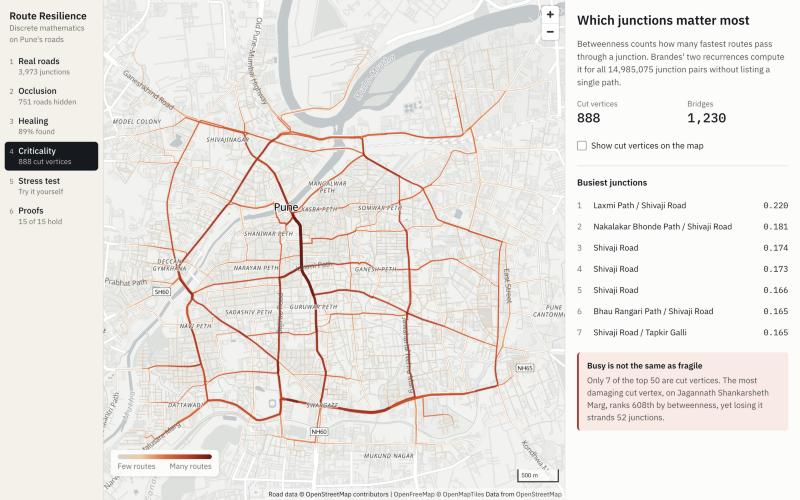

# Route Resilience

Discrete mathematics applied to the real road network of central Pune: simulate what satellites lose under tree cover, heal the broken graph, find the junctions the city depends on, and test what happens when they fail.

Built as a Discrete Mathematics course project from Problem Statement 4 of ISRO's [Bharatiya Antariksh Hackathon 2026](https://hack2skill.com/event/bah2026/). The full write-up with proofs is in [report/REPORT.md](report/REPORT.md).



## Key findings

| Finding | Evidence |
|---|---|
| Kruskal alone reconnects the map but restores no redundancy | All 204 links are bridges, and the cycle count stays at 905 |
| A loop-closure pass fixes this | Gaps found rise from 25.0% to 89.5%, and travel-time error falls from 49.1% to 0.84% |
| The problem statement's Resilience Index can mislead | It rises to 1.018 under attack while efficiency falls to 0.953 |
| Busy is not the same as fragile | Only 7 of the top 50 junctions are cut vertices |
| Adaptive attacks are stronger | 1.9 times the damage of a fixed ranking |
| Random-graph theory fails on roads | Predicted collapse at 48.6% survival, simulated at 74.3% |

Healing results hold across 20 random scenes: 89.4% recall (SD 0.9) and 94.0% precision (SD 0.7).

## Run it

You need [uv](https://docs.astral.sh/uv/) and Node.js 24 or later.

```bash
uv sync
```

```bash
npm --prefix web ci
```

```bash
npm --prefix web run build
```

```bash
uv run route-resilience serve
```

Then open <http://127.0.0.1:8000>. The first start runs the full analysis, which takes about 90 seconds. Later starts take a few seconds.

Other useful commands:

```bash
uv run pytest
```

```bash
uv run route-resilience build
```

For frontend development, keep the server running and start Vite with hot reload at <http://localhost:5173>:

```bash
npm --prefix web run dev
```

## Where each syllabus unit appears

| Unit | Used for | Code |
|---|---|---|
| 1. Logic and proofs | Healing gates, equivalence classes, proofs of correctness | [healing.py](src/route_resilience/healing.py), [dsu.py](src/route_resilience/dsu.py) |
| 2. Basic counting | Failure scenarios, double counting, handshake lemma | [combinatorics.py](src/route_resilience/combinatorics.py), [theorems.py](src/route_resilience/theorems.py) |
| 3. Advanced combinatorics | Pigeonhole on routes, inclusion-exclusion on trips, onto functions | [flows.py](src/route_resilience/flows.py), [route_hits.py](src/route_resilience/route_hits.py) |
| 4. Recurrences and generating functions | Brandes' recurrences, ladder recurrence, percolation, repair budgets | [centrality.py](src/route_resilience/centrality.py), [combinatorics.py](src/route_resilience/combinatorics.py) |
| 5. Modular arithmetic | Repeatable shuffles, CRT grid keys | [number_theory.py](src/route_resilience/number_theory.py) |
| 6. Graph theory | Everything else: Dijkstra, Tarjan, Euler tours, matching, colouring | [paths.py](src/route_resilience/paths.py), [connectivity.py](src/route_resilience/connectivity.py), [euler.py](src/route_resilience/euler.py), [matching.py](src/route_resilience/matching.py), [colouring.py](src/route_resilience/colouring.py) |

## How it fits together

```text
data/pune_core.json.gz      Road snapshot extracted from OpenStreetMap
scripts/extract_osm.py      Rebuilds that snapshot from a raw .osm.pbf file
src/route_resilience/       Algorithms, pipeline and API
tests/                      65 tests, checked against NetworkX and brute force
web/                        React dashboard
report/REPORT.md            Proofs, results and limitations
```

The algorithms are written from scratch. NetworkX is used as an independent reference in the tests, and at runtime only for the planarity test, triangle counts and the general matching step in the inspection tour. SciPy runs the repeated shortest-path searches in the stress test, and those results are checked against NetworkX in the tests.

## Technology

Python 3.14, uv, FastAPI, NumPy, SciPy, Ruff, pytest with Hypothesis, React 19, TypeScript 7, Vite 8, Tailwind CSS 4, MapLibre GL 6, and GitHub Actions.

## Limits

Occlusion is simulated, so there is no satellite imagery or deep learning here. One-way streets are ignored, speeds are assumed, and every junction pair counts equally. See section 9 of the [report](report/REPORT.md) for the full list.

## Data licence

Road data © OpenStreetMap contributors, available under the [Open Database License](https://www.openstreetmap.org/copyright). The basemap comes from OpenFreeMap and OpenMapTiles.
